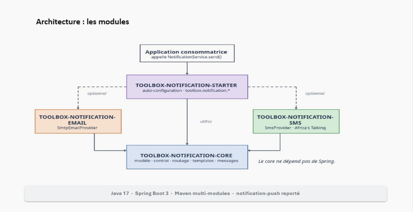

### Vue d'ensemble de l'architecture
Toolbox Notification est une bibliothèque Maven multi-modules, pensée pour être intégrée dans des applications Spring Boot. L'application n'interagit qu'avec le service de notification ; les fournisseurs Email et SMS restent en arrière-plan.

Les modules disponibles :

- `notification-core` : modèles, service et composants principaux ;
- `notification-email` : support de l'email via SMTP ;
- `notification-sms` : support du SMS via Africa's Talking ;
- `notification-starter` : intégration et auto-configuration Spring Boot.

Une application n'embarque que les modules dont elle a besoin. Si vous n'envoyez que des emails, le Starter et le module Email suffisent.

