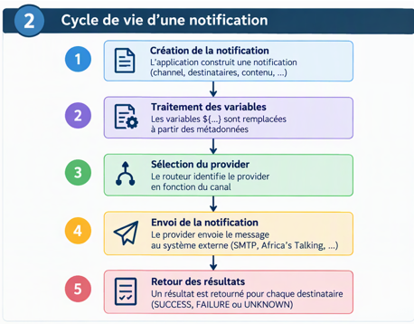
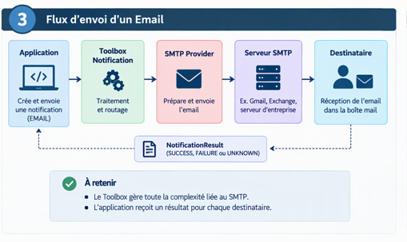
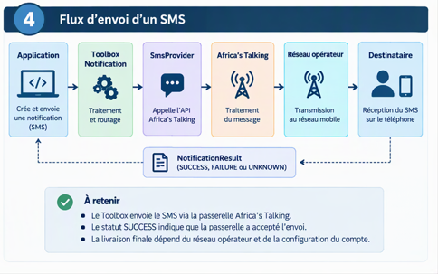

### 1. Cycle de vie d'une notification

Quel que soit le canal, le traitement suit les mêmes étapes :

1. **Création** : l'application construit une `Notification` avec le builder.
2. **Envoi** : elle la transmet à `notificationService.send(...)`.
3. **Variables** : les `${...}` du sujet et du contenu sont remplacés à partir des métadonnées. Par exemple, `Bonjour ${nom}` devient `Bonjour Rakoto`.
4. **Sélection du fournisseur** : Toolbox choisit automatiquement le fournisseur correspondant au canal.
5. **Transmission** : le fournisseur envoie le message au système externe (serveur SMTP ou Africa's Talking).
6. **Résultats** : Toolbox renvoie une liste de `NotificationResult`, un par destinataire.

### 2. Flux Email et SMS

Les deux canaux partagent le même parcours jusqu'au choix du fournisseur. La différence se situe uniquement dans la dernière étape.

**Email.** Le message est préparé puis remis au serveur SMTP configuré.

**SMS.** Le message est transmis à Africa's Talking par requête HTTP.

Dans les deux cas, l'application passe toujours par `NotificationService` et ne contacte jamais un fournisseur directement.