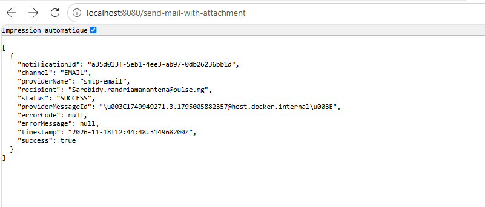
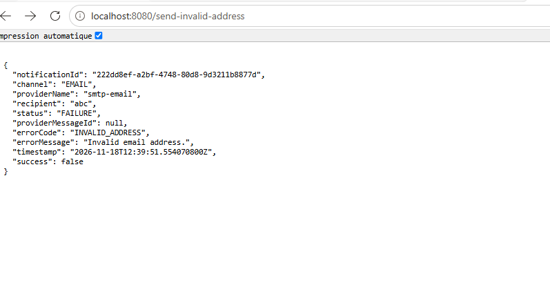

Chaque envoi produit un `NotificationResult` par destinataire. Il indique si le fournisseur a accepté la demande, l'a refusée, ou si l'issue reste incertaine.

### 1. Statuts

Le statut est porté par l'énumération `NotificationStatus`.

#### SUCCESS

Le fournisseur a accepté la demande : le serveur SMTP a pris l'email en charge, ou Africa's Talking a accepté la requête SMS.



:::caution
`SUCCESS` ne prouve pas que le message est arrivé. La livraison finale dépend ensuite du serveur de messagerie du destinataire, de ses filtres anti-spam ou du réseau mobile. Ne déclenchez donc pas de logique métier qui supposerait que le message a été lu ou même reçu.
:::

#### FAILURE

L'échec est certain. C'est le cas, par exemple, d'une adresse email ou d'un numéro invalide, d'une configuration incorrecte ou d'un timeout survenu avant la transmission.

Une adresse comme `abc` produit généralement :

```text
status    : FAILURE
errorCode : INVALID_ADDRESS
```



#### UNKNOWN

Le résultat ne peut pas être déterminé. Cela arrive quand une erreur technique survient après l'envoi de la requête, mais avant la réponse du fournisseur, par exemple une connexion coupée en plein échange avec la passerelle SMS.

Le message a peut-être été envoyé, mais Toolbox ne peut pas le confirmer. Avant de renvoyer, vérifiez si un doublon serait gênant pour votre cas d'usage.


