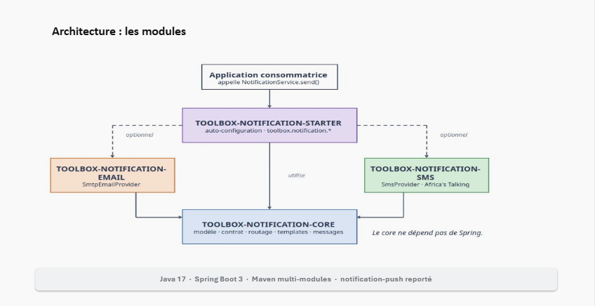
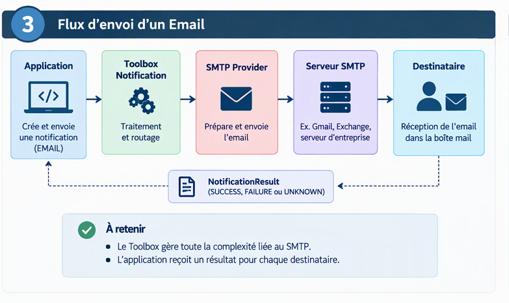
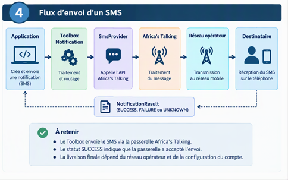
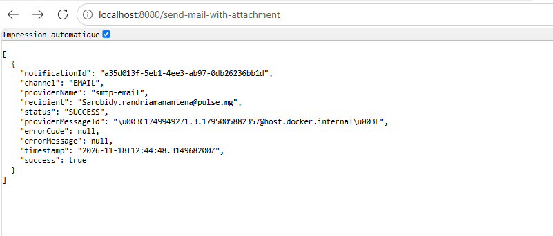
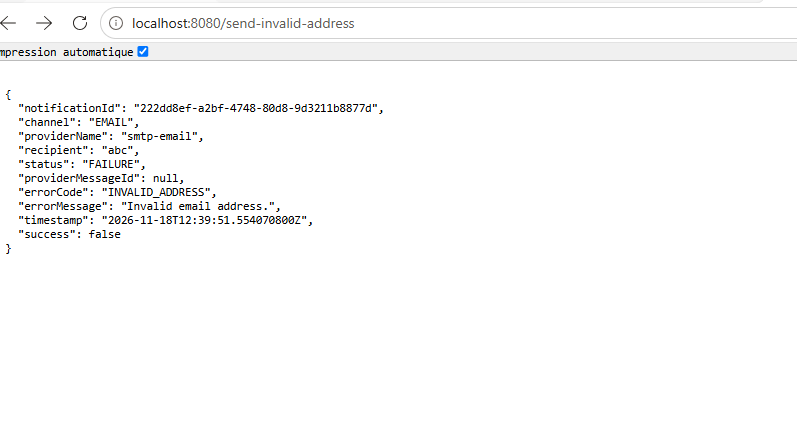

# Toolbox Notification

Toolbox Notification est une bibliothèque Java 17 pour Spring Boot 3 qui centralise l'envoi d'emails et de SMS dans vos applications. Un seul point d'entrée, une seule configuration, un résultat clair pour chaque destinataire.

---

## 1. Introduction

### 1.1 Présentation et objectifs

Dans beaucoup de projets, l'envoi d'emails et de SMS est codé directement dans l'application. Chaque équipe réécrit sa propre logique d'envoi, sa propre configuration et sa propre gestion des erreurs. Résultat : du code dupliqué, des comportements qui diffèrent d'un projet à l'autre, et des corrections à répéter partout.

Toolbox Notification répond à ce problème. L'application construit une notification, la transmet au service, et récupère les résultats :

```java
List<NotificationResult> results = notificationService.send(notification);
```

Le choix du canal, le traitement des variables et la communication avec les fournisseurs sont gérés par la bibliothèque. Vous n'avez à manipuler directement ni serveur SMTP ni API SMS.

L'objectif est de proposer une solution simple à intégrer, réutilisable d'une application à l'autre, cohérente dans son comportement et facile à étendre.

### 1.2 Fonctionnalités principales et canaux disponibles

Toolbox Notification propose une API commune pour deux canaux :

- **EMAIL** : envoi via SMTP ;
- **SMS** : envoi via Africa's Talking.

Un troisième canal, `PUSH`, existe dans l'énumération `Channel` mais est réservé aux évolutions futures.

Une notification est toujours associée à un seul canal. Pour envoyer un email et un SMS, il faut donc créer deux notifications.

La bibliothèque permet de :

- envoyer des emails via SMTP (validé avec Gmail) ;
- envoyer des SMS via Africa's Talking ;
- insérer des variables dans le sujet et le contenu (`${nom}`, `${numero}`...) ;
- envoyer à un ou plusieurs destinataires ;
- joindre des fichiers aux emails ;
- obtenir un résultat individuel par destinataire ;
- s'intégrer automatiquement à Spring Boot grâce à un Starter.

:::info
Un statut `SUCCESS` signifie que le fournisseur a **accepté** la demande d'envoi. Il ne garantit pas que le message est arrivé chez le destinataire. Voir la section [5.1](#51-statuts).
:::

---

## 2. Architecture et fonctionnement

### 2.1 Vue d'ensemble de l'architecture

Toolbox Notification est une bibliothèque Maven multi-modules, pensée pour être intégrée dans des applications Spring Boot. L'application n'interagit qu'avec le service de notification ; les fournisseurs Email et SMS restent en arrière-plan.

Les modules disponibles :

- `notification-core` : modèles, service et composants principaux ;
- `notification-email` : support de l'email via SMTP ;
- `notification-sms` : support du SMS via Africa's Talking ;
- `notification-starter` : intégration et auto-configuration Spring Boot.

Une application n'embarque que les modules dont elle a besoin. Si vous n'envoyez que des emails, le Starter et le module Email suffisent.



### 2.2 Cycle de vie d'une notification

Quel que soit le canal, le traitement suit les mêmes étapes :

1. **Création** : l'application construit une `Notification` avec le builder.
2. **Envoi** : elle la transmet à `notificationService.send(...)`.
3. **Variables** : les `${...}` du sujet et du contenu sont remplacés à partir des métadonnées. Par exemple, `Bonjour ${nom}` devient `Bonjour Rakoto`.
4. **Sélection du fournisseur** : Toolbox choisit automatiquement le fournisseur correspondant au canal.
5. **Transmission** : le fournisseur envoie le message au système externe (serveur SMTP ou Africa's Talking).
6. **Résultats** : Toolbox renvoie une liste de `NotificationResult`, un par destinataire.


### 2.3 Flux Email et SMS

Les deux canaux partagent le même parcours jusqu'au choix du fournisseur. La différence se situe uniquement dans la dernière étape.

**Email.** Le message est préparé puis remis au serveur SMTP configuré.



**SMS.** Le message est transmis à Africa's Talking par requête HTTP.



Dans les deux cas, l'application passe toujours par `NotificationService` et ne contacte jamais un fournisseur directement.

---

## 3. Installation et configuration

### 3.1 Prérequis

- Java 17 ou supérieur ;
- Spring Boot 3 ;
- Maven ;
- pour l'email : un serveur SMTP (Gmail, par exemple) ;
- pour le SMS : un compte Africa's Talking et une clé API.


## 3.2 Récupération et compilation du Toolbox

Commencez par récupérer le code source du projet :

```bash
git clone https://repository.pulse.mg/gitlab/toolbox-notification.git
```

Positionnez-vous à la racine du projet puis exécutez :

```bash
mvn clean install
```

Cette commande :

- compile tous les modules ;
- génère les JAR ;
- installe les artefacts dans le dépôt Maven local (`~/.m2/repository`).

Une fois cette étape terminée, les modules du Toolbox peuvent être utilisés comme dépendances dans une autre application.

---

## 3.3 Intégration dans une application Spring Boot
Créez ou utilisez une application Spring Boot puis ajoutez les dépendances nécessaires.

### 3.4 Dépendances Maven

Ajoutez le Starter, puis les modules correspondant aux canaux que vous utilisez.

:::note
Les coordonnées ci-dessous (`groupId`, version) sont indicatives. Remplacez-les par celles de votre dépôt Maven interne.
:::

```xml
<!-- Starter Spring Boot -->
<dependency>
    <groupId>com.pulse.toolbox.notification</groupId>
    <artifactId>TOOLBOX-NOTIFICATION-STARTER</artifactId>
    <version>1.0.0-SNAPSHOT</version>
</dependency>

<!-- Canal Email -->
<dependency>
    <groupId>com.pulse.toolbox.notification</groupId>
    <artifactId>TOOLBOX-NOTIFICATION-EMAIL</artifactId>
    <version>1.0.0-SNAPSHOT</version>
</dependency>

<!-- Canal SMS -->
<dependency>
    <groupId>com.pulse.toolbox.notification</groupId>
    <artifactId>TOOLBOX-NOTIFICATION-SMS</artifactId>
    <version>1.0.0-SNAPSHOT</version>
</dependency>
```

Ne gardez que les modules utiles. Si le module d'un canal est absent et que vous envoyez une notification sur ce canal, aucun fournisseur ne sera trouvé et l'envoi échouera.

### 3.5 Intégration Spring Boot

Le Starter fournit l'auto-configuration : il n'y a aucune annotation à ajouter. Une fois les dépendances présentes et la configuration renseignée, `NotificationService` est disponible en injection :

```java
import com.pulse.toolbox.notification.core.service.NotificationService;
import org.springframework.stereotype.Service;

@Service
public class WelcomeService {

    private final NotificationService notificationService;

    public WelcomeService(NotificationService notificationService) {
        this.notificationService = notificationService;
    }
}
```

### 3.4 Configuration Email

Toolbox Notification utilise un provider SMTP pour l'envoi des emails.

La configuration exacte dépend du serveur SMTP utilisé dans votre environnement (Gmail, Microsoft 365, serveur SMTP d'entreprise, etc.).

Exemple de configuration :

Dans `application.yml` :

```yaml
spring:
  mail:
    host: smtp.gmail.com
    port: 587
    username: ${SMTP_USER}
    password: ${SMTP_PASSWORD}
    properties:
      mail:
        smtp:
          auth: true
          starttls:
            enable: true

toolbox:
  notification:
    email:
      provider: smtp
      from: ${SMTP_USER}
      host: smtp.gmail.com
      port: 587
      username: ${SMTP_USER}
      password: ${SMTP_PASSWORD}
```

:::tip
Avec Gmail, utilisez un **mot de passe d'application** plutôt que le mot de passe du compte.
:::

### 3.5 Configuration SMS

```yaml
toolbox:
  notification:
    sms:
      provider: africastalking
      url: https://api.sandbox.africastalking.com/version1/messaging
      api-key: ${SMS_API_KEY}
      username: sandbox
      default-country-code: "+261"
```

L'exemple utilise l'environnement **Sandbox** d'Africa's Talking, pratique pour les tests. En production, remplacez l'URL, le nom d'utilisateur et la clé API par ceux de votre compte réel.

### 3.6 Gestion des secrets

Ne placez jamais de mots de passe ni de clés API en clair dans le dépôt. Les exemples ci-dessus utilisent des variables d'environnement (`${SMTP_USER}`, `${SMTP_PASSWORD}`, `${SMS_API_KEY}`) que Spring résout au démarrage :

```bash
export SMTP_USER=notifications@exemple.com
export SMTP_PASSWORD=mot-de-passe-application
export SMS_API_KEY=votre-cle-api
```

En production, préférez le mécanisme de secrets de votre plateforme (Kubernetes Secrets, coffre-fort, variables du pipeline CI/CD).

:::warning
Ne versionnez jamais un fichier contenant des identifiants réels. Ajoutez-le à votre `.gitignore`.
:::

---

## 4. Utilisation

### 4.1 Structure d'une notification

La classe `Notification` est l'objet central de la bibliothèque. Elle se construit avec un builder :

```java
Notification notification = Notification.builder()
        .channel(Channel.EMAIL)
        .recipient("client@example.com")
        .subject("Bienvenue")
        .content("Bonjour")
        .build();
```

Les champs disponibles :

- `channel` (obligatoire) : `EMAIL` ou `SMS` ;
- `recipient` (obligatoire) : un ou plusieurs destinataires ;
- `content` (obligatoire) : le contenu du message ;
- `subject` : le sujet (pour les emails) ;
- `metadata` : les valeurs des variables utilisées dans le sujet et le contenu ;
- `attachment` : les pièces jointes (emails uniquement).

L'envoi se fait ensuite par un appel unique :

```java
List<NotificationResult> results = notificationService.send(notification);
```

### 4.2 Envoi d'un Email

```java
Notification notification = Notification.builder()
        .channel(Channel.EMAIL)
        .recipient("client@example.com")
        .subject("Bienvenue")
        .content("Bonjour et bienvenue sur notre plateforme.")
        .build();

List<NotificationResult> results = notificationService.send(notification);
```

Ce scénario a été validé avec un serveur SMTP Gmail.

### 4.3 Envoi d'un SMS

```java
Notification notification = Notification.builder()
        .channel(Channel.SMS)
        .recipient("+261340000000")
        .content("Bonjour depuis Toolbox Notification.")
        .build();

List<NotificationResult> results = notificationService.send(notification);
```

Le numéro doit être au format international. Si vous renseignez un numéro local, `default-country-code` est utilisé pour le compléter.

### 4.4 Variables et templates

Le sujet et le contenu acceptent des variables au format `${nom}`. Leurs valeurs sont fournies via `metadata` :

```java
Notification notification = Notification.builder()
        .channel(Channel.EMAIL)
        .recipient("client@example.com")
        .subject("Bienvenue ${nom}")
        .content("""
                Bonjour ${nom},

                Votre numéro client est ${numero}.
                """)
        .metadata("nom", "Rakoto")
        .metadata("numero", "CLI-2026-001")
        .build();

notificationService.send(notification);
```

Le destinataire reçoit :

```text
Sujet : Bienvenue Rakoto

Bonjour Rakoto,

Votre numéro client est CLI-2026-001.
```

Les variables fonctionnent de la même façon pour les SMS.

:::warning
Toute variable utilisée doit avoir une valeur dans `metadata`. Sinon, une `TemplateException` est levée **avant** l'envoi : aucun message ne part tant que la variable n'est pas renseignée.
:::

### 4.5 Pièces jointes

Une pièce jointe se crée à partir d'un nom, d'un type MIME et du contenu du fichier :

```java
Attachment attachment = new Attachment(
        "document.pdf",
        "application/pdf",
        fileContent
);

Notification notification = Notification.builder()
        .channel(Channel.EMAIL)
        .recipient("client@example.com")
        .subject("Document")
        .content("Veuillez trouver le document ci-joint.")
        .attachment(attachment)
        .build();

notificationService.send(notification);
```

Pour joindre un fichier présent dans les ressources du projet :

```java
ClassPathResource resource = new ClassPathResource("demo/document.pdf");
byte[] fileContent = resource.getInputStream().readAllBytes();
```

Les pièces jointes ne sont acceptées que sur le canal `EMAIL`. En ajouter une à une notification SMS provoque une erreur dès la construction de la notification.

### 4.6 Plusieurs destinataires

Il suffit d'appeler `recipient(...)` plusieurs fois. Cela fonctionne pour les emails comme pour les SMS :

```java
Notification notification = Notification.builder()
        .channel(Channel.EMAIL)
        .recipient("user1@example.com")
        .recipient("user2@example.com")
        .recipient("user3@example.com")
        .subject("Information")
        .content("Message de démonstration.")
        .build();

List<NotificationResult> results = notificationService.send(notification);
```

Vous obtenez autant de résultats que de destinataires, chacun avec son propre statut :

```text
user1@example.com -> SUCCESS
user2@example.com -> SUCCESS
user3@example.com -> FAILURE
```

L'échec d'un destinataire n'empêche pas le traitement des autres.

### 4.7 Lecture des résultats

Parcourez la liste retournée et réagissez selon le statut :

```java
for (NotificationResult result : results) {
    switch (result.status()) {
        case SUCCESS -> System.out.println("Notification acceptée");
        case FAILURE -> System.out.println("Erreur : " + result.errorCode());
        case UNKNOWN -> System.out.println("Résultat incertain");
    }
}
```

Le détail des statuts et des codes d'erreur est expliqué dans le chapitre suivant.

---

## 5. Résultats et gestion des erreurs

Chaque envoi produit un `NotificationResult` par destinataire. Il indique si le fournisseur a accepté la demande, l'a refusée, ou si l'issue reste incertaine.

### 5.1 Statuts

Le statut est porté par l'énumération `NotificationStatus`.

#### SUCCESS

Le fournisseur a accepté la demande : le serveur SMTP a pris l'email en charge, ou Africa's Talking a accepté la requête SMS.



:::caution
`SUCCESS` ne prouve pas que le message est arrivé. La livraison finale dépend ensuite du serveur de messagerie du destinataire, de ses filtres anti-spam ou du réseau mobile. Ne déclenchez donc pas de logique métier qui supposerait que le message a été lu ou même reçu.
:::

#### FAILURE

L'échec est certain. C'est le cas, par exemple, d'une adresse email ou d'un numéro invalide, d'une configuration incorrecte ou d'un timeout survenu avant la transmission.

Une adresse comme `abc` produit généralement :

```text
status    : FAILURE
errorCode : INVALID_ADDRESS
```



#### UNKNOWN

Le résultat ne peut pas être déterminé. Cela arrive quand une erreur technique survient après l'envoi de la requête, mais avant la réponse du fournisseur, par exemple une connexion coupée en plein échange avec la passerelle SMS.

Le message a peut-être été envoyé, mais Toolbox ne peut pas le confirmer. Avant de renvoyer, vérifiez si un doublon serait gênant pour votre cas d'usage.

### 5.2 Codes d'erreur

Quand un problème est détecté, le résultat contient un code d'erreur. Il permet à l'application de réagir sans analyser les messages techniques des fournisseurs.

| Code | Signification |
|------|---------------|
| `PROVIDER_ERROR` | Erreur générique du fournisseur |
| `INVALID_ADDRESS` | Adresse email invalide |
| `INVALID_NUMBER` | Numéro de téléphone invalide |
| `ATTACHMENT_TOO_LARGE` | Taille maximale des pièces jointes dépassée |
| `TIMEOUT` | Délai d'attente dépassé |
| `DELIVERY_UNKNOWN` | Livraison impossible à confirmer |

### 5.3 Limites connues

La version actuelle ne fournit pas :

- de persistance des notifications ;
- d'historique des envois ;
- de retry automatique ;
- de métriques intégrées ;
- de support du canal `PUSH`.

Chaque notification est envoyée une seule fois. Si vous avez besoin de rejouer un envoi, la logique de retry reste à la charge de l'application. Ces fonctionnalités pourront être ajoutées dans les prochaines versions.

---

## 6. Extension et personnalisation

Dans la plupart des cas, les fournisseurs fournis par la bibliothèque suffisent. Si vous devez brancher une passerelle spécifique ou un système interne, vous pouvez écrire votre propre fournisseur.

### 6.1 Provider personnalisé

Un provider est le composant qui réalise l'envoi réel pour un canal. Il implémente l'interface `NotificationProvider` :

```java
@Component
public class CustomSmsProvider implements NotificationProvider {

    @Override
    public String getName() {
        return "custom-sms";
    }

    @Override
    public Channel getChannel() {
        return Channel.SMS;
    }

    @Override
    public List<NotificationResult> send(Notification notification) {
        // Votre logique d'envoi

        return List.of();
    }
}
```

Votre provider doit respecter ces règles :

- ne gérer qu'un seul canal ;
- retourner un résultat par destinataire, dans le même ordre que les destinataires ;
- ne jamais retourner `null` ;
- utiliser uniquement les statuts `SUCCESS`, `FAILURE` ou `UNKNOWN`.

### 6.2 Sélection des providers

Le choix du fournisseur est automatique : un email utilise le provider Email, un SMS le provider SMS.

Si votre application déclare son propre provider pour un canal, il est utilisé **à la place** de celui de Toolbox. Vous pouvez ainsi remplacer le comportement par défaut sans toucher à la bibliothèque. Par exemple, un `CustomEmailProvider` déclaré dans votre application remplace le provider SMTP fourni.

Un seul provider peut être actif par canal :

```text
EMAIL -> CustomEmailProvider    (valide)
SMS   -> SmsProvider            (valide)

EMAIL -> ProviderA              (invalide)
EMAIL -> ProviderB
```

Si deux providers sont déclarés pour le même canal, Toolbox signale une erreur de configuration plutôt que de choisir au hasard.

:::tip
Réservez les providers personnalisés aux besoins que les implémentations standard ne couvrent pas.
:::

---

# 7. FAQ

> ❓ **Pourquoi ai-je un statut `SUCCESS` mais aucun email reçu ?**

`SUCCESS` signifie que le serveur SMTP a accepté la demande d'envoi.

Cela ne garantit pas que le message a déjà été reçu par le destinataire. La livraison dépend ensuite du serveur de destination, des filtres anti-spam, d'une éventuelle quarantaine ou d'une boîte mail saturée.

Pensez à vérifier le dossier des courriers indésirables.

---

> ❓ **Pourquoi ai-je un statut `SUCCESS` mais aucun SMS reçu ?**

Le fournisseur SMS a accepté la demande d'envoi, mais la livraison finale dépend de la passerelle SMS et du réseau mobile.

Lors de nos tests avec Africa's Talking Sandbox, les requêtes étaient correctement acceptées par la plateforme sans être nécessairement délivrées sur un numéro malgache réel.

La Sandbox permet de valider l'intégration technique mais ne garantit pas la réception effective du SMS.

---

> ❓ **Pourquoi une `TemplateException` est-elle levée ?**

Une variable utilisée dans le sujet ou le contenu n'a pas de valeur correspondante dans les métadonnées.

Exemple :

```java
.content("Bonjour ${nom}")
```

sans :

```java
.metadata("nom", "Rakoto")
```

Dans ce cas, Toolbox bloque l'envoi avant toute tentative de transmission.

---

> ❓ **Pourquoi aucun provider n'est-il trouvé ?**

Cette erreur apparaît lorsqu'aucun fournisseur n'est enregistré pour le canal demandé.

Les causes les plus fréquentes sont :

- le module Email ou SMS n'est pas présent dans les dépendances Maven ;
- le provider n'est pas configuré ;
- la configuration du provider est incomplète ou invalide.

---

> ❓ **Peut-on envoyer un email et un SMS avec une seule notification ?**

Non.

Une notification est associée à un seul canal.

Pour envoyer un Email et un SMS, il faut construire deux notifications distinctes.

---

> ❓ **Les pièces jointes sont-elles supportées pour les SMS ?**

Non.

Les pièces jointes sont réservées au canal Email.

Toute tentative d'ajouter une pièce jointe à une notification SMS provoque une erreur lors de la construction de la notification.

---

> ❓ **Peut-on utiliser plusieurs destinataires ?**

Oui.

Les canaux Email et SMS supportent plusieurs destinataires.

Un résultat est retourné pour chaque destinataire.

---

> ❓ **Toolbox conserve-t-il un historique des envois ?**

Non.

Le Toolbox ne stocke :

- aucun historique ;
- aucune notification ;
- aucun template ;
- aucune trace des envois.

Si un historique est nécessaire, l'application consommatrice doit stocker les `NotificationResult`.

---

> ❓ **Toolbox effectue-t-il des retries automatiques ?**

Non.

Chaque notification est envoyée une seule fois.

Les éventuels mécanismes de retry restent sous la responsabilité de l'application qui utilise Toolbox Notification.

---
