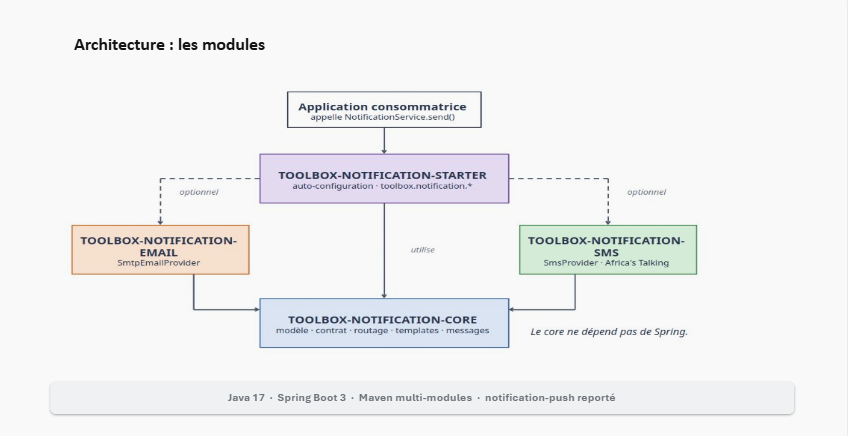
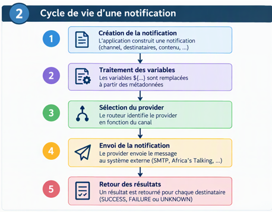
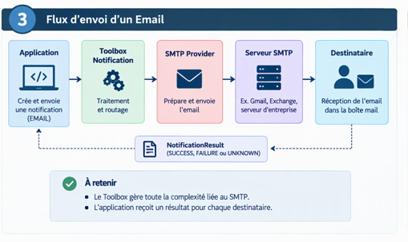
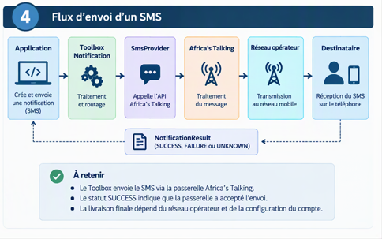
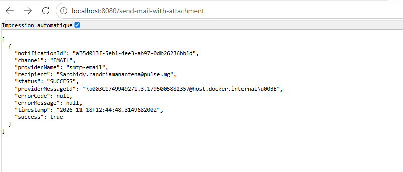
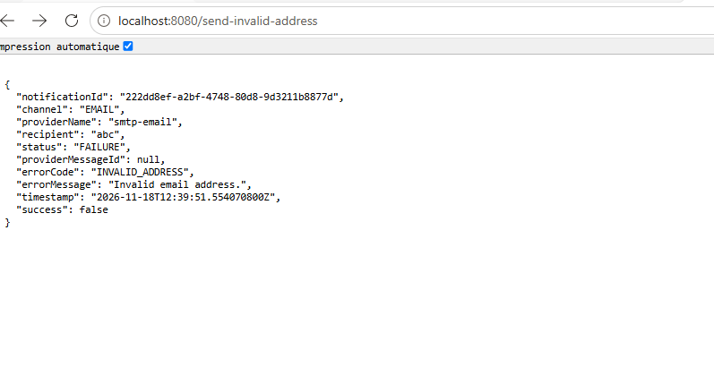

# Toolbox Notification

Toolbox Notification is a Java 17 library for Spring Boot 3 that centralizes the sending of emails and SMS in your applications. A single entry point, a single configuration, and a clear result for each recipient.

---

## 1. Introduction

### 1.1 Overview and objectives

In many projects, sending emails and SMS is coded directly into the application. Each team rewrites its own sending logic, its own configuration and its own error handling. The result: duplicated code, behaviors that differ from one project to another, and fixes that have to be repeated everywhere.

Toolbox Notification addresses this problem. The application builds a notification, passes it to the service, and retrieves the results:

```java
List<NotificationResult> results = notificationService.send(notification);
```

Channel selection, variable processing and communication with providers are handled by the library. You do not have to directly handle either an SMTP server or an SMS API.

The goal is to offer a solution that is simple to integrate, reusable from one application to another, consistent in its behavior and easy to extend.

### 1.2 Main features and available channels

Toolbox Notification offers a common API for two channels:

- **EMAIL**: sending via SMTP;
- **SMS**: sending via Africa's Talking.

A third channel, `PUSH`, exists in the `Channel` enumeration but is reserved for future developments.

A notification is always associated with a single channel. To send an email and an SMS, you therefore need to create two notifications.

The library allows you to:

- send emails via SMTP (validated with Gmail);
- send SMS via Africa's Talking;
- insert variables in the subject and the content (`${nom}`, `${numero}`...);
- send to one or more recipients;
- attach files to emails;
- get an individual result for each recipient;
- integrate automatically with Spring Boot thanks to a Starter.

:::info
A `SUCCESS` status means that the provider has **accepted** the sending request. It does not guarantee that the message has reached the recipient. See section [5.1](#51-statuses).
:::

---

## 2. Architecture and operation

### 2.1 Architecture overview

Toolbox Notification is a multi-module Maven library, designed to be integrated into Spring Boot applications. The application only interacts with the notification service; the Email and SMS providers remain in the background.

The available modules:

- `notification-core`: models, service and main components;
- `notification-email`: email support via SMTP;
- `notification-sms`: SMS support via Africa's Talking;
- `notification-starter`: Spring Boot integration and auto-configuration.

An application only includes the modules it needs. If you only send emails, the Starter and the Email module are enough.



### 2.2 Lifecycle of a notification

Whatever the channel, processing follows the same steps:

1. **Creation**: the application builds a `Notification` with the builder.
2. **Sending**: it passes it to `notificationService.send(...)`.
3. **Variables**: the `${...}` in the subject and the content are replaced from the metadata. For example, `Bonjour ${nom}` becomes `Bonjour Rakoto`.
4. **Provider selection**: Toolbox automatically chooses the provider matching the channel.
5. **Transmission**: the provider sends the message to the external system (SMTP server or Africa's Talking).
6. **Results**: Toolbox returns a list of `NotificationResult`, one per recipient.



### 2.3 Email and SMS flows

Both channels share the same path up to the provider selection. The difference lies only in the last step.

**Email.** The message is prepared and then handed over to the configured SMTP server.



**SMS.** The message is transmitted to Africa's Talking via an HTTP request.



In both cases, the application always goes through `NotificationService` and never contacts a provider directly.

---

## 3. Installation and configuration

### 3.1 Prerequisites

- Java 17 or higher;
- Spring Boot 3;
- Maven;
- for email: an SMTP server (Gmail, for example);
- for SMS: an Africa's Talking account and an API key.


## 3.2 Retrieving and building the Toolbox

Start by retrieving the project's source code:

```bash
git clone https://repository.pulse.mg/gitlab/toolbox-notification.git
```

Go to the project root and then run:

```bash
mvn clean install
```

This command:

- compiles all the modules;
- generates the JARs;
- installs the artifacts in the local Maven repository (`~/.m2/repository`).

Once this step is complete, the Toolbox modules can be used as dependencies in another application.

---

## 3.3 Integration into a Spring Boot application
Create or use a Spring Boot application and then add the necessary dependencies.

### 3.4 Maven dependencies

Add the Starter, then the modules corresponding to the channels you use.

:::note
The coordinates below (`groupId`, version) are indicative. Replace them with those of your internal Maven repository.
:::

```xml
<!-- Starter Spring Boot -->
<dependency>
    <groupId>com.pulse.toolbox.notification</groupId>
    <artifactId>TOOLBOX-NOTIFICATION-STARTER</artifactId>
    <version>1.0.0-SNAPSHOT</version>
</dependency>

<!-- Canal Email -->
<dependency>
    <groupId>com.pulse.toolbox.notification</groupId>
    <artifactId>TOOLBOX-NOTIFICATION-EMAIL</artifactId>
    <version>1.0.0-SNAPSHOT</version>
</dependency>

<!-- Canal SMS -->
<dependency>
    <groupId>com.pulse.toolbox.notification</groupId>
    <artifactId>TOOLBOX-NOTIFICATION-SMS</artifactId>
    <version>1.0.0-SNAPSHOT</version>
</dependency>
```

Only keep the modules you need. If a channel's module is missing and you send a notification on that channel, no provider will be found and the sending will fail.

### 3.5 Spring Boot integration

The Starter provides auto-configuration: there is no annotation to add. Once the dependencies are present and the configuration is filled in, `NotificationService` is available for injection:

```java
import com.pulse.toolbox.notification.core.service.NotificationService;
import org.springframework.stereotype.Service;

@Service
public class WelcomeService {

    private final NotificationService notificationService;

    public WelcomeService(NotificationService notificationService) {
        this.notificationService = notificationService;
    }
}
```

### 3.4 Email configuration

Toolbox Notification uses an SMTP provider to send emails.

The exact configuration depends on the SMTP server used in your environment (Gmail, Microsoft 365, corporate SMTP server, etc.).

Example configuration:

In `application.yml`:

```yaml
spring:
  mail:
    host: smtp.gmail.com
    port: 587
    username: ${SMTP_USER}
    password: ${SMTP_PASSWORD}
    properties:
      mail:
        smtp:
          auth: true
          starttls:
            enable: true

toolbox:
  notification:
    email:
      provider: smtp
      from: ${SMTP_USER}
      host: smtp.gmail.com
      port: 587
      username: ${SMTP_USER}
      password: ${SMTP_PASSWORD}
```

:::tip
With Gmail, use an **app password** rather than the account password.
:::

### 3.5 SMS configuration

```yaml
toolbox:
  notification:
    sms:
      provider: africastalking
      url: https://api.sandbox.africastalking.com/version1/messaging
      api-key: ${SMS_API_KEY}
      username: sandbox
      default-country-code: "+261"
```

The example uses the Africa's Talking **Sandbox** environment, which is convenient for testing. In production, replace the URL, the username and the API key with those of your real account.

### 3.6 Secrets management

Never put passwords or API keys in plain text in the repository. The examples above use environment variables (`${SMTP_USER}`, `${SMTP_PASSWORD}`, `${SMS_API_KEY}`) that Spring resolves at startup:

```bash
export SMTP_USER=notifications@exemple.com
export SMTP_PASSWORD=mot-de-passe-application
export SMS_API_KEY=votre-cle-api
```

In production, prefer your platform's secrets mechanism (Kubernetes Secrets, vault, CI/CD pipeline variables).

:::warning
Never commit a file containing real credentials. Add it to your `.gitignore`.
:::

---

## 4. Usage

### 4.1 Structure of a notification

The `Notification` class is the central object of the library. It is built with a builder:

```java
Notification notification = Notification.builder()
        .channel(Channel.EMAIL)
        .recipient("client@example.com")
        .subject("Bienvenue")
        .content("Bonjour")
        .build();
```

The available fields:

- `channel` (required): `EMAIL` or `SMS`;
- `recipient` (required): one or more recipients;
- `content` (required): the content of the message;
- `subject`: the subject (for emails);
- `metadata`: the values of the variables used in the subject and the content;
- `attachment`: the attachments (emails only).

Sending is then done with a single call:

```java
List<NotificationResult> results = notificationService.send(notification);
```

### 4.2 Sending an Email

```java
Notification notification = Notification.builder()
        .channel(Channel.EMAIL)
        .recipient("client@example.com")
        .subject("Bienvenue")
        .content("Bonjour et bienvenue sur notre plateforme.")
        .build();

List<NotificationResult> results = notificationService.send(notification);
```

This scenario has been validated with a Gmail SMTP server.

### 4.3 Sending an SMS

```java
Notification notification = Notification.builder()
        .channel(Channel.SMS)
        .recipient("+261340000000")
        .content("Bonjour depuis Toolbox Notification.")
        .build();

List<NotificationResult> results = notificationService.send(notification);
```

The number must be in international format. If you provide a local number, `default-country-code` is used to complete it.

### 4.4 Variables and templates

The subject and the content accept variables in the `${nom}` format. Their values are provided via `metadata`:

```java
Notification notification = Notification.builder()
        .channel(Channel.EMAIL)
        .recipient("client@example.com")
        .subject("Bienvenue ${nom}")
        .content("""
                Bonjour ${nom},

                Votre numéro client est ${numero}.
                """)
        .metadata("nom", "Rakoto")
        .metadata("numero", "CLI-2026-001")
        .build();

notificationService.send(notification);
```

The recipient receives:

```text
Sujet : Bienvenue Rakoto

Bonjour Rakoto,

Votre numéro client est CLI-2026-001.
```

Variables work the same way for SMS.

:::warning
Every variable used must have a value in `metadata`. Otherwise, a `TemplateException` is thrown **before** sending: no message is sent until the variable is provided.
:::

### 4.5 Attachments

An attachment is created from a name, a MIME type and the content of the file:

```java
Attachment attachment = new Attachment(
        "document.pdf",
        "application/pdf",
        fileContent
);

Notification notification = Notification.builder()
        .channel(Channel.EMAIL)
        .recipient("client@example.com")
        .subject("Document")
        .content("Veuillez trouver le document ci-joint.")
        .attachment(attachment)
        .build();

notificationService.send(notification);
```

To attach a file present in the project's resources:

```java
ClassPathResource resource = new ClassPathResource("demo/document.pdf");
byte[] fileContent = resource.getInputStream().readAllBytes();
```

Attachments are only accepted on the `EMAIL` channel. Adding one to an SMS notification causes an error as soon as the notification is built.

### 4.6 Multiple recipients

Simply call `recipient(...)` several times. This works for emails as well as for SMS:

```java
Notification notification = Notification.builder()
        .channel(Channel.EMAIL)
        .recipient("user1@example.com")
        .recipient("user2@example.com")
        .recipient("user3@example.com")
        .subject("Information")
        .content("Message de démonstration.")
        .build();

List<NotificationResult> results = notificationService.send(notification);
```

You get as many results as there are recipients, each with its own status:

```text
user1@example.com -> SUCCESS
user2@example.com -> SUCCESS
user3@example.com -> FAILURE
```

The failure of one recipient does not prevent the others from being processed.

### 4.7 Reading the results

Iterate over the returned list and react according to the status:

```java
for (NotificationResult result : results) {
    switch (result.status()) {
        case SUCCESS -> System.out.println("Notification acceptée");
        case FAILURE -> System.out.println("Erreur : " + result.errorCode());
        case UNKNOWN -> System.out.println("Résultat incertain");
    }
}
```

The details of the statuses and error codes are explained in the next chapter.

---

## 5. Results and error handling

Each sending produces one `NotificationResult` per recipient. It indicates whether the provider accepted the request, rejected it, or whether the outcome remains uncertain.

### 5.1 Statuses

The status is carried by the `NotificationStatus` enumeration.

#### SUCCESS

The provider accepted the request: the SMTP server took charge of the email, or Africa's Talking accepted the SMS request.



:::caution
`SUCCESS` does not prove that the message has arrived. Final delivery then depends on the recipient's mail server, its anti-spam filters or the mobile network. Do not therefore trigger business logic that would assume the message has been read or even received.
:::

#### FAILURE

The failure is certain. This is the case, for example, with an invalid email address or phone number, an incorrect configuration or a timeout occurring before transmission.

An address such as `abc` usually produces:

```text
status    : FAILURE
errorCode : INVALID_ADDRESS
```



#### UNKNOWN

The result cannot be determined. This happens when a technical error occurs after the request has been sent, but before the provider's response, for example a connection cut in the middle of an exchange with the SMS gateway.

The message may have been sent, but Toolbox cannot confirm it. Before resending, check whether a duplicate would be a problem for your use case.

### 5.2 Error codes

When a problem is detected, the result contains an error code. It allows the application to react without parsing the providers' technical messages.

| Code | Meaning |
|------|---------|
| `PROVIDER_ERROR` | Generic provider error |
| `INVALID_ADDRESS` | Invalid email address |
| `INVALID_NUMBER` | Invalid phone number |
| `ATTACHMENT_TOO_LARGE` | Maximum attachment size exceeded |
| `TIMEOUT` | Timeout exceeded |
| `DELIVERY_UNKNOWN` | Delivery cannot be confirmed |

### 5.3 Known limitations

The current version does not provide:

- persistence of notifications;
- sending history;
- automatic retry;
- built-in metrics;
- support for the `PUSH` channel.

Each notification is sent only once. If you need to replay a sending, the retry logic remains the responsibility of the application. These features may be added in future versions.

---

## 6. Extension and customization

In most cases, the providers supplied by the library are sufficient. If you need to plug in a specific gateway or an internal system, you can write your own provider.

### 6.1 Custom provider

A provider is the component that performs the actual sending for a channel. It implements the `NotificationProvider` interface:

```java
@Component
public class CustomSmsProvider implements NotificationProvider {

    @Override
    public String getName() {
        return "custom-sms";
    }

    @Override
    public Channel getChannel() {
        return Channel.SMS;
    }

    @Override
    public List<NotificationResult> send(Notification notification) {
        // Votre logique d'envoi

        return List.of();
    }
}
```

Your provider must follow these rules:

- handle only a single channel;
- return one result per recipient, in the same order as the recipients;
- never return `null`;
- use only the `SUCCESS`, `FAILURE` or `UNKNOWN` statuses.

### 6.2 Provider selection

The provider choice is automatic: an email uses the Email provider, an SMS the SMS provider.

If your application declares its own provider for a channel, it is used **instead of** the Toolbox one. You can thus replace the default behavior without touching the library. For example, a `CustomEmailProvider` declared in your application replaces the supplied SMTP provider.

Only one provider can be active per channel:

```text
EMAIL -> CustomEmailProvider    (valide)
SMS   -> SmsProvider            (valide)

EMAIL -> ProviderA              (invalide)
EMAIL -> ProviderB
```

If two providers are declared for the same channel, Toolbox reports a configuration error rather than choosing at random.

:::tip
Reserve custom providers for needs that the standard implementations do not cover.
:::

---

# 7. FAQ

> ❓ **Why do I get a `SUCCESS` status but no email received?**

`SUCCESS` means that the SMTP server accepted the sending request.

It does not guarantee that the message has already been received by the recipient. Delivery then depends on the destination server, anti-spam filters, a possible quarantine or a full mailbox.

Remember to check the spam folder.

---

> ❓ **Why do I get a `SUCCESS` status but no SMS received?**

The SMS provider accepted the sending request, but final delivery depends on the SMS gateway and the mobile network.

During our tests with the Africa's Talking Sandbox, requests were correctly accepted by the platform without necessarily being delivered to a real Malagasy number.

The Sandbox makes it possible to validate the technical integration but does not guarantee the actual reception of the SMS.

---

> ❓ **Why is a `TemplateException` thrown?**

A variable used in the subject or the content has no corresponding value in the metadata.

Example:

```java
.content("Bonjour ${nom}")
```

without:

```java
.metadata("nom", "Rakoto")
```

In this case, Toolbox blocks the sending before any transmission attempt.

---

> ❓ **Why is no provider found?**

This error appears when no provider is registered for the requested channel.

The most frequent causes are:

- the Email or SMS module is not present in the Maven dependencies;
- the provider is not configured;
- the provider's configuration is incomplete or invalid.

---

> ❓ **Can an email and an SMS be sent with a single notification?**

No.

A notification is associated with a single channel.

To send an Email and an SMS, you must build two separate notifications.

---

> ❓ **Are attachments supported for SMS?**

No.

Attachments are reserved for the Email channel.

Any attempt to add an attachment to an SMS notification causes an error when the notification is built.

---

> ❓ **Can multiple recipients be used?**

Yes.

The Email and SMS channels support multiple recipients.

One result is returned for each recipient.

---

> ❓ **Does Toolbox keep a history of sendings?**

No.

The Toolbox does not store:

- any history;
- any notification;
- any template;
- any trace of sendings.

If a history is needed, the consuming application must store the `NotificationResult`s.

---

> ❓ **Does Toolbox perform automatic retries?**

No.

Each notification is sent only once.

Any retry mechanisms remain the responsibility of the application that uses Toolbox Notification.

---